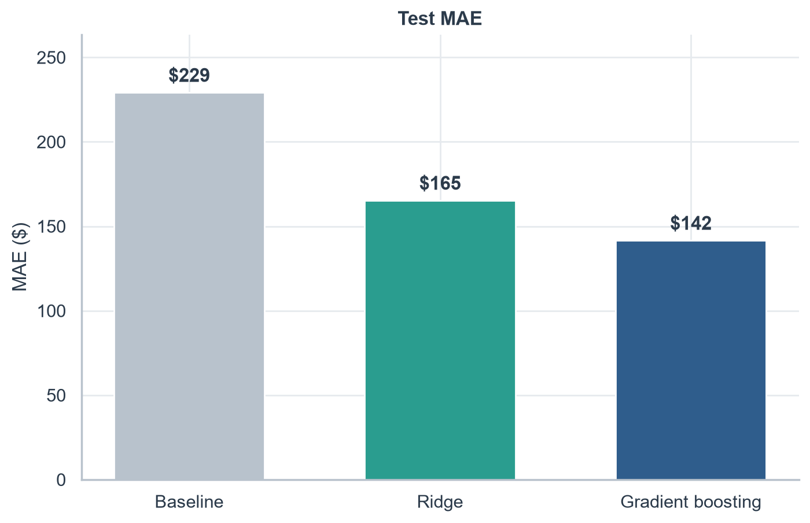
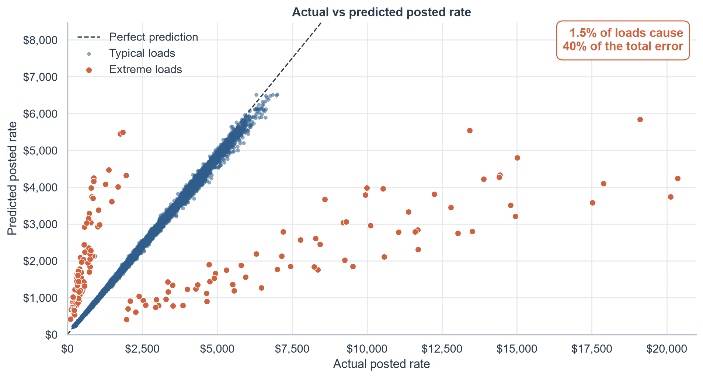
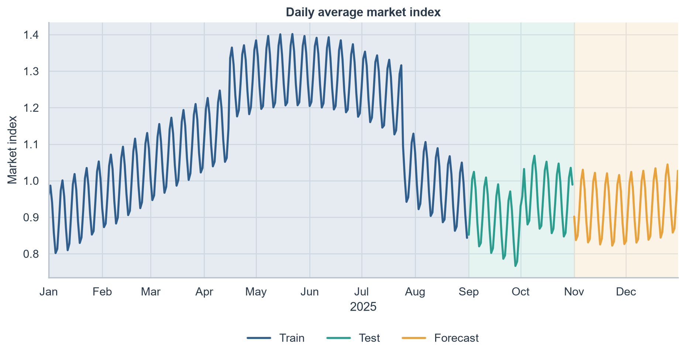
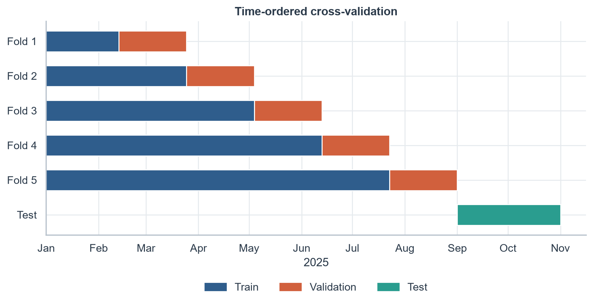

# Freight Rate Forecasting

[](https://github.com/AdrianeJone/freight-rate-forecasting/actions/workflows/ci.yml)

Time-aware forecasting of freight load rates with scikit-learn and Optuna. The model predicts the posted rate of a load from its lane, distance, equipment, weight, date and two market signals, and is validated the way it will be used: trained on the past, tested on the future. A FastAPI service serves the trained model.

**Headline result:** a tuned HistGradientBoosting model cuts held-out test MAE by 38% against a rate-per-mile baseline ($229 to $142, 6.0% MAPE).

## Problem

Given 48,000 labeled loads from January to October 2025, predict the rate of 12,000 unseen loads dated November to December 2025. Because every prediction target falls after all the training data, this is a forecasting problem, and the validation design follows from that. The forecast period has no labels, so every score below comes from a held-out test period inside the labeled data.

## Results

Held-out test period: September to October 2025 (9,523 loads), scored once after tuning.

| Model                                        | CV MAE | Test MAE | Test MAPE |
|----------------------------------------------|--------|----------|-----------|
| Baseline (median rate per mile by equipment) | $204   | $229     | 10.5%     |
| Ridge (tuned)                                | $115   | $165     | 7.1%      |
| HistGradientBoosting (tuned)                 | $123   | **$142** | **6.0%**  |

The final model cuts test MAE by 38% against the baseline. Cross-validation slightly favored Ridge, while the test period favored HistGradientBoosting, so choosing between them on the test score makes that number mildly optimistic. No tuning was done after seeing it.





## Approach

- **Time-based split.** Train: January to August. Test: September to October. A random split would let the model see days on both sides of every test day and overstate accuracy. Market conditions also shift through the year, so the split follows the calendar.



- **Time-ordered cross-validation.** Five expanding-window folds built on unique dates, so a model is never scored on days before its training data, and loads from one day never straddle a fold boundary.



- **No leakage.** Scaling, one-hot encoding and a KNN imputer are fit on training data only.
- **Robust to unseen locations.** The validation set has 8 cities never seen in training, so locations enter the model as coordinates and distance, not city names.
- **Model.** HistGradientBoosting on log(rate) with an absolute-error loss, tuned with Optuna (TPE sampler, 30 trials, fixed seed). Ridge was tuned the same way, with the same folds and metric, for a fair comparison. Random Forest was run with default settings only, as an extra reference.
- **Final fit.** The chosen settings are refit on all labeled data before predicting the forecast period.

## What the error analysis found

- About 1.5% of loads are extreme price spikes, above and below the prediction, that no available feature explains. They cause about 40% of the total absolute error. Without them, test MAE falls from $142 to $86.
- Error is similar across distance bands and equipment types (MAPE roughly 5.6% to 6.7%), so no segment is notably weak.
- Typical loads are under-predicted by about 1% to 3.5%, both on the test period and in cross-validation. A possible cause is an upward rate drift the features do not capture. This was not tested.

## Data

The dataset is private and is not included in this repository. Each row is a load with these columns: `load_id`, `pickup`, `delivery`, `pickup_lat`, `pickup_lon`, `delivery_lat`, `delivery_lon`, `distance`, `equipment`, `weight`, `date`, `market_index`, `quote_signal`, and the target `posted_rate` (labeled data only).

Data quality issues handled:

- 292 negative weights, treated as sign errors and converted with the absolute value.
- Weight capped at 47,500 lb (1,191 loads at the cap).
- Missing `weight` (0.6%) and `market_index` (0.8%), filled by a KNN imputer.

## Setup

Requires Python 3.10+. From the repo root (Windows PowerShell):

```
python -m venv freight-env
.\freight-env\Scripts\Activate.ps1
python -m pip install -r requirements.txt
```

On macOS or Linux, activate with `source freight-env/bin/activate`.

## Run

To run this on your own data, place files with the same schema in a `data/` folder, using these file names: `train-test.csv`, `validation.csv`, `validation-predictions-template.csv`, `december-chart-inputs.csv`. Then:

```
python src/make_predictions.py --data-dir data --out-dir outputs
```

This fits the final model on all labeled data and writes the forecast files to `outputs/`. The Optuna search runs in `notebooks/02_modeling.ipynb`, and the script uses the best settings it found, stored in `src/pipeline.py`.

## Serve the model as an API

Fit the final model and save it. The saved file is not committed, because the KNN imputer stores training rows:

```
python src/train_model.py --data-dir data
```

Start the service and open the interactive docs at `http://127.0.0.1:8000/docs`:

```
uvicorn api:app --app-dir src
```

Endpoints:

- `GET /health` reports whether the model is loaded.
- `POST /predict` takes one load and returns its predicted rate. `weight` and `market_index` are optional and are imputed when missing. Invalid input (unknown equipment, non-positive distance, a malformed date, out-of-range coordinates) returns a 422 error.

Example request (PowerShell):

```
Invoke-RestMethod -Uri http://127.0.0.1:8000/predict -Method Post -ContentType "application/json" -Body '{"pickup_lat": 36.99152, "pickup_lon": -84.99876, "delivery_lat": 41.31561, "delivery_lon": -85.36206, "distance": 360, "equipment": "Dry Van", "weight": 32000, "date": "2025-12-03", "market_index": 0.994063, "quote_signal": 2.053293}'
```

Response:

```
{"predicted_rate": 796.36}
```

## Tests

```
python -m pip install -r requirements-dev.txt
python -m pytest
```

The tests build a small synthetic dataset with the same schema and the same data-quality problems as the real data (negative and missing weights, missing `market_index`), so they run without the private data. They cover feature cleaning, the model pipeline and the API (health, valid and invalid requests). GitHub Actions runs them on every push.

## Repository layout

| Path                          | Purpose                                                                         |
|-------------------------------|---------------------------------------------------------------------------------|
| `notebooks/01_eda.ipynb`      | Exploratory data analysis                                                       |
| `notebooks/02_modeling.ipynb` | Split, preprocessing, model comparison, tuning, test evaluation, error analysis |
| `src/pipeline.py`             | Cleaning, features, preprocessing and final model                               |
| `src/make_predictions.py`     | Rebuilds the forecast files from the raw data                                   |
| `src/train_model.py`          | Fits the final model and saves it for the API                                   |
| `src/api.py`                  | FastAPI prediction service                                                      |
| `tests/`                      | Pytest suite on synthetic data                                                  |
| `.github/workflows/ci.yml`    | Runs the tests on every push                                                    |
| `images/`                     | Figures used in this README                                                     |

## Limitations

- The extreme price spikes cannot be predicted from the available features.
- The small under-prediction of typical loads may persist in the forecast period.
- Random Forest was compared with default settings only and was not tuned.
- The search budget was kept small (30 trials per model).
- The model was selected on the test period after cross-validation favored Ridge, so the reported test MAE is mildly optimistic.
- The dataset is private, so the reported numbers cannot be reproduced from this repository alone.
- The API runs locally and is not containerized or deployed, and the tests check behavior on synthetic data, not model accuracy.

## License

MIT. See [LICENSE](LICENSE).